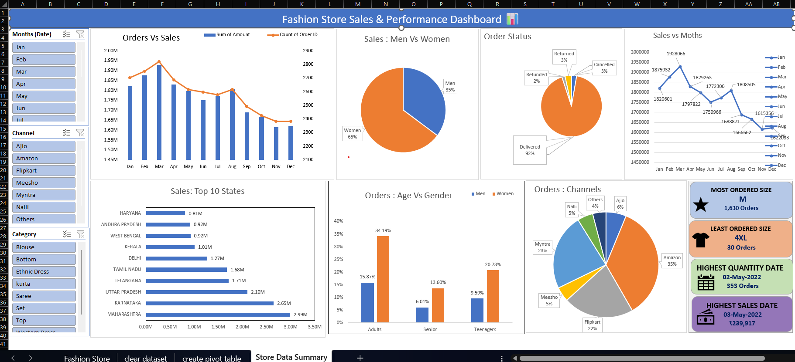

#  Store Data Analysis & Sales Dashboard

An interactive **Excel dashboard** developed to analyze store sales performance, customer behavior, order trends, and business insights.

##  Dashboard

## 🛠️ Tools & Skills

- Microsoft Excel
- Power Query
- Pivot Tables
- Pivot Charts
- Slicers & Timelines
- Data Cleaning
- Data Analysis
- Data Visualization

## 📈 Key Analysis

- Monthly sales and order analysis
- Sales performance by category
- Customer and gender analysis
- Top-performing states
- Order channel analysis
- Product and size performance
- Interactive filtering using slicers and timelines

## Business Insights

The dashboard helps identify **sales trends, high-performing categories, customer patterns, and important business opportunities** through interactive Excel visualizations.

## Project Files

- [Excel Dashboard](./Store-Data-Analysis.xlsx)
- [Dashboard](./Dashboard.png)

## Author

**Pragati Bhor**

Final-Year B.E. Artificial Intelligence & Data Science Student  
Aspiring Data Analyst | Python | SQL | Excel
